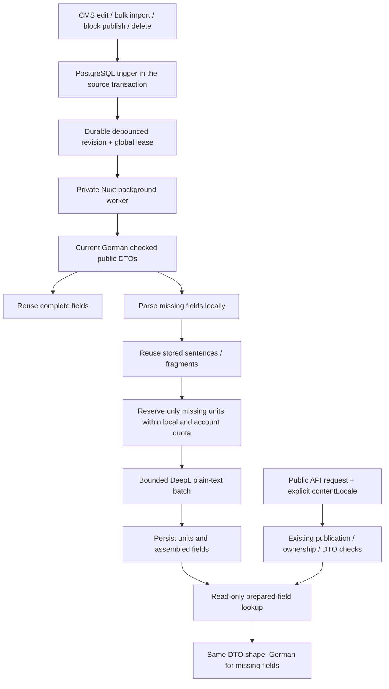

# DeepL CMS content translation

The integration is implemented. **Generation is disabled until you supply a private API key
and enable it.** German (`de-DE`) remains the source; prepared content targets English
(`en-GB`) and Italian (`it-IT`). Page requests only read prepared translations. They never
contact DeepL, create jobs, reserve credits or write translation data.

The existing typed DE/EN/IT interface dictionaries remain separate. Machine translated
content has a maintained three-language notice; previews and candidate access pages are
excluded. Missing translations fall back to the current German field. Incomplete or failed
lookups are `no-store`, so completed preparation becomes visible on the next request.

## Minimising usage

- Persist complete fields **and smaller sentence/text units** in PostgreSQL. There is no
  expiry or restart-based eviction of paid translations. Redis is not the durable copy.
- Read a ready field directly. When a field changes, reuse its unchanged sentences and
  text fragments; translate only missing units. Markup-only edits need no new translations.
- Deduplicate identical provider inputs across records, headings, bodies and list/detail
  responses. Each target language has its own memory. Reverting an edit or republishing
  unchanged content can reuse earlier results.
- Parse HTML and Markdown locally. Only natural-language text leaves are submitted as
  plain text. Keep markup, destinations, code, SVG, specifications, placeholders, email
  addresses, submitted choices, IDs, dates, numbers, scores and proper-name fields local.
  Translate image alt/title prose; retain the original destinations and technical attributes.
- Debounce committed source changes for 30 seconds. Skip technical-only changes through
  the source-column manifest. Reconcile every 15 minutes to recover missed/new content.
- Recheck the committed source revision before every paid batch. An edited/unpublished
  source invalidates an older plan; already received translations remain reusable privately.
- Check DeepL's reported account and API-key quota before each paid request, then atomically
  reserve the local budget. Batch up to 50 strings / 10,000 source code points, with an
  additional 120 KiB encoded-body bound below DeepL's 128 KiB limit.
- Do not automatically retry a timed-out, malformed or failed 5xx translation request: it
  may already have been billed. Quarantine its units and retain the conservative reservation.
  Retrying the same database commit is safe and does not call DeepL again.

Text units share a fixed, public climate-domain context, so an identical unit/target/model/
policy has identical provider inputs. Their keys therefore do not depend on record IDs,
array positions or whether the text came from a heading, HTML or Markdown. Complete-field
keys still include the actual format and display-field context required by the public DTO.
The unbilled provider context contains no private surrounding records.

Formatting is reconstructed with `htmlparser2`/`dom-serializer` and the maintained mdast/GFM
parsers and serializer. Provider text is escaped by those serializers, rather than becoming
new tags, links or code. Markdown formatting may be normalised while retaining semantics.
Inline HTML boundaries and `translate="no"`/`notranslate`/code exclusions are preserved.

## Installation and activation

The local schema, endpoint extension and private worker identity have been prepared. For a
new deployment, use the following sequence from the repository root. Directus stays on
**11.17.4**.

1. Install/build the new extension, or use `./bin/check_extensions.sh --build` for all:

   ```bash
   npm --prefix src/directus/extensions/content-translations ci
   npm --prefix src/directus/extensions/content-translations run build
   ```

2. Import the maintained YAML and outbox definition:

   ```bash
   docker compose -f docker-compose.yaml exec directus /directus/cli/import-all.sh
   ```

3. Restart Directus to load the compiled endpoint:

   ```bash
   docker restart stadt-land-klima-directus-1
   ```

4. Provision the isolated identity using the existing private CLI administrator credential.
   The output is a **secret** assignment intended for `src/frontend/.env`; redirect it into
   a private file and transfer it there, without committing it or putting it under `public`:

   ```bash
   umask 077
   docker compose -f docker-compose.yaml exec -T -e DIRECTUS_URL=http://127.0.0.1:8055 directus \
     /directus/cli/node_modules/.bin/tsx /directus/cli/provisionTranslationWorker.ts \
     > /private/path/translation-worker.env
   ```

   The assignment is `CONTENT_TRANSLATION_WORKER_TOKEN`. Provisioning reuses an existing
   valid identity/token and refuses conflicting accounts; it does not rotate credentials.

5. In private `src/frontend/.env`, add your key and enable the integration:

   ```dotenv
   DEEPL_API_KEY=your-private-key
   CONTENT_TRANSLATION_ENABLED=true
   ```

   `CONTENT_TRANSLATION_WORKER_TOKEN` must already be configured. The key, worker token and
   provider settings belong only to private runtime configuration. No browser SDK, public
   config, payload, URL or log receives the credentials. Development reloads configuration;
   production needs a frontend process restart to apply private environment changes.

6. Inspect status and a bounded first backfill. Review EN/IT meaning, climate terminology,
   tone and political statements before treating machine output as reviewed editorial copy.
   Real provider quality/account behaviour cannot be verified without your key. You can
   remove the key to pause generation while continuing to serve prepared translations.
   Setting `CONTENT_TRANSLATION_ENABLED=false` disables the reader as well.

A normal first run starts after the debounce/poll window, generally within 30–90 seconds.
Preparation continues in the background. A partially translated site remains usable through
field-level German fallback; supplying a key does not synchronously translate every page.

### Budgets

These are backend-enforced defaults in `src/directus/.env.example`:

```dotenv
DEEPL_MAX_TOTAL_CHARACTERS=450000
DEEPL_MAX_DAILY_CHARACTERS=50000
```

The total is a **lifetime local reservation ceiling**. It does not reset on deployment,
restart, API-key rotation, glossary changes or namespace changes. The daily ceiling uses
UTC reservation dates. Ambiguous requests remain reserved because they may have consumed
quota; definitive rate/quota/auth/validation rejections refund their local reservation.
The provider's own quota is checked independently. Limits apply across all frontend replicas.

For a smaller first quality pilot, lower the ceilings before enabling, for example 20,000
in total and 5,000/day. Raising a total later does not erase previously used characters.
Daily exhaustion schedules preparation for the next UTC day; total exhaustion waits for an
intentional limit increase and enqueue. Set account/key limits in DeepL too if available.
Never delete memory or counters as a way to refresh content: that can re-bill existing work.

DeepL currently describes a new API Developer allowance of **1,000,000 characters in total**,
without monthly renewal. Legacy API Free has 500,000/month and is unavailable to new accounts.
Check the selected account's actual quota/terms; this application does not create an account,
choose a paid subscription or upgrade a plan. See [official plans](https://support.deepl.com/hc/en-us/articles/360021200939-DeepL-API-plans)
and [usage limits](https://developers.deepl.com/docs/resources/usage-limits).

### Optional provider settings

| Frontend private setting                  | Default                    | Effect                                                                                                                                                   |
| ----------------------------------------- | -------------------------- | -------------------------------------------------------------------------------------------------------------------------------------------------------- |
| `DEEPL_API_ENDPOINT`                      | `auto`                     | Legacy `:fx` keys use `api-free.deepl.com`; other keys use `api.deepl.com`. Explicit `free`/`standard` are supported. No fallback host or arbitrary URL. |
| `DEEPL_MODEL`                             | `prefer_quality_optimized` | Explicit model selection; supported alternatives are `quality_optimized` and `latency_optimized`.                                                        |
| `DEEPL_GLOSSARY_EN` / `DEEPL_GLOSSARY_IT` | empty                      | Optional language-pair glossary UUIDs. Source is always `DE`; targets are `EN-GB` and `IT`.                                                              |
| `DEEPL_POLICY_REVISION`                   | `v1`                       | Intentional terminology/adapter rebuild revision. Keep stable during ordinary content edits.                                                             |

Namespace keys include model, glossary IDs and policy revision, but exclude the API key and
account endpoint so rotating a key does not throw away purchased translations. Changing
translation semantics deliberately changes the namespace; an existing worker refuses an
implicit namespace rebuild. In-place glossary changes need an explicit policy-revision bump.

Print the desired namespace without an API key or network request:

```bash
cd bin/test_suite
node --env-file=../../src/frontend/.env --import tsx src/deepLNamespace.ts
```

Use that value with the operator enqueue command below. A namespace switch is refused while
another worker holds a live lease; pause generation and wait for it to finish/expire first.
Changing namespaces is an intentional regeneration decision, not routine cache maintenance.

## Operator controls

Inside the Directus container, using its existing private CLI administrator credential:

```bash
DIRECTUS_URL=http://127.0.0.1:8055 /directus/cli/node_modules/.bin/tsx /directus/cli/contentTranslations.ts status
DIRECTUS_URL=http://127.0.0.1:8055 /directus/cli/node_modules/.bin/tsx /directus/cli/contentTranslations.ts enqueue
DIRECTUS_URL=http://127.0.0.1:8055 /directus/cli/node_modules/.bin/tsx /directus/cli/contentTranslations.ts enqueue desired-namespace
```

`status` returns job/revision/lease timing, per-state counts, local reserved/billed totals,
limits and up to 50 attention keys. It returns neither source bodies nor translations/keys
for the provider. `enqueue` debounces a fresh source sweep; unchanged content stays free.

For an uncertain request, first inspect the provider's usage and the attention list. An
operator can explicitly allow another attempt, which **may consume credits again**:

```bash
DIRECTUS_URL=http://127.0.0.1:8055 /directus/cli/node_modules/.bin/tsx /directus/cli/contentTranslations.ts \
  retry content-translation:v1:the-64-character-hash --allow-rebill
```

The previous ambiguous reservation is retained. Up to 50 comma-separated keys are allowed.
Workers cannot invoke operator enqueue/retry actions. Write controls use the central 5/minute
limit; status uses 10/minute. The normal worker spaces writes to stay within that limit.

## Request, persistence and publication boundaries



Collections are defined in YAML under `src/directus/schema/`:

| Collection                     | Purpose                                                                                                                             |
| ------------------------------ | ----------------------------------------------------------------------------------------------------------------------------------- |
| `content_translation_memory`   | Immutable reusable unit/field keys, target, state, prepared text, reservation and attempt accounting. No copied German source body. |
| `content_translation_jobs`     | One coalesced public-content revision, debounce/reconciliation time, namespace, worker lease and fixed diagnostic code.             |
| `content_translation_usage`    | Atomic lifetime and UTC-day reservations/billed counters.                                                                           |
| `content_translation_requests` | Bounded sliding-window control-request accounting shared by replicas.                                                               |

The code-first importer additionally runs `src/directus/cli/installTranslationOutbox.ts`.
Directus YAML cannot represent PostgreSQL triggers. This maintained installer is therefore
the source of their definition; there are no manual replacement DB edits or startup DDL.
Pinned 11.17.4's normal update filter precedes its inner transaction, so an after-save hook
alone would not be an atomic outbox. Database triggers cover those paths, explicit block
transactions and SQL imports. The manifest tracks relevant text, ownership, publication,
privacy and service-permission changes, without storing their values in jobs.

The worker enumerates all published identities with pagination, then reads each body through
the existing checked public Nuxt endpoints in German. Parent/report publication is rechecked;
drafts, previews, private candidate sessions and raw CMS exports never go to DeepL. Inactive
construction copy and unpublished report text/media are skipped. Collection/field selection
lives in the maintained route/block registry, not a blanket recursive string translator.
Source, store and provider calls have deadlines. Prerendering does not start generation.

No separate translation publication binding is needed: an HTTP lookup derives hashes only
from the **already authorised current DTO**. Editing immediately changes the eligible key;
unpublishing/deleting removes the source from the public response regardless of retained
memory. Old results can be retained privately and reused after an exact revert/republish.
Existing source-response cache lifetimes still bound revocation; translation storage does
not create an extra public source cache.

`Frontend-Server` can read only ready field results through its private policy. The distinct
`Content-Translation-Worker` has no ordinary source-collection or translation-table access;
it uses the bounded persistence endpoint after active-user/role/email verification. Only
operators may request a new namespace or retry ambiguous work. Public/asset/preview/editor
identities have no translation collection/control access. `roles/public.yaml` is unchanged.

## Offline usage estimate

Create a private JSON array of **already checked German public DTO responses**:

```json
[
  {
    "path": "/api/public/pages/example",
    "data": { "page": { "name": "Klimaschutz", "contents": "<p>Gemeinsam handeln.</p>" } }
  }
]
```

From `bin/test_suite`:

```bash
npm run plan:content-translation -- /absolute/path/to/public-dto-snapshots.json --deepl
```

The report contains counts only: complete-field/source-format volume and the deduplicated
text-unit code points actually eligible for DeepL in each/both targets. Markup, code and
protected values are excluded from the DeepL estimate. There are no network calls, keys or
writes. The input stays private/local; do not commit it. Limits are 1,000 snapshots / 10 MB.

This is a cold-backfill estimate for the supplied sample, not an invoice or remaining quota.
Existing memory reduces generation further; retries/new edits can add work. Include details,
blocks, catalog versions and publication scopes for a representative inventory. The live
source-inventory regression traversed 146 checked source responses in the local dataset.

On a local sample of 10 checked responses, complete source fields contained 290,036 code
points across both targets. Parsing and shared text-unit deduplication reduced the cold
DeepL estimate to 131,740 (about 55% less), with no unsupported fields. This sample is not
the full site; the first real provider run and translation quality still require your key.

## Implementation and regression coverage

| Area                                                   | Implementation                                                                                                                                                                                                | Coverage                                                                                                                                                                                                                                                                                                                                |
| ------------------------------------------------------ | ------------------------------------------------------------------------------------------------------------------------------------------------------------------------------------------------------------- | --------------------------------------------------------------------------------------------------------------------------------------------------------------------------------------------------------------------------------------------------------------------------------------------------------------------------------------- |
| HTTP locale / read-only overlay                        | `composables/useContentFetch.ts`; `shared/contentTranslation.ts`; `server/utils/contentTranslation.ts`; `server/plugins/content-translation.ts`                                                               | Targeted automated: `contentTranslation.test.ts`, including actual H3 serialization, locale isolation, immutable fallback and no generation from page requests.                                                                                                                                                                         |
| Format protection, provider and economical preparation | `server/utils/{contentTranslationFormat,deepLTranslation,contentTranslationWorker}.ts`                                                                                                                        | Targeted automated: `deepLTranslation.test.ts` — markup/Markdown/GFM/code/link/placeholder preservation, escaped output, quota/batch bounds, no paid retries, cross-field reuse, one-sentence edits, reverts, markup-only changes and disabled/missing-key startup. Real EN/IT translation quality is manual-only and not yet measured. |
| Persistence and durable outbox                         | `server/utils/contentTranslationPersistence.ts`; `server/plugins/content-translation-worker.ts`; private YAML; `src/directus/cli/installTranslationOutbox.ts`; `src/directus/extensions/content-translations` | Targeted automated: `contentTranslationDatabase.test.ts` in the database profile — atomic source rollback, concurrent leases/reservations, idempotent commit, budgets, safe refunds, ambiguous/crashed requests, stale source, control rate limits, real role denials and full source enumeration.                                      |
| UI locale / notice                                     | `plugins/directus.server.ts`; `layouts/default.vue`; `components/LanguageSelector.vue`; DE/EN/IT `translation.machine_notice` keys                                                                            | Targeted automated locale flow: `sharedStateFlow.ts` (SSR, hydration, saved preference, reload preserving route/query/fragment); notice and stored overlay also checked in the keyless-reader acceptance profile.                                                                                                                       |

Run from the repository root:

```bash
npm --prefix src/frontend run typecheck
npm --prefix bin/test_suite run typecheck
npm --prefix bin/test_suite run test:content-translation
npm --prefix bin/test_suite run test:content-translation:database
cd bin && ./test_dev.sh
```

For the keyless frontend restart/SSR acceptance check, stop other Nuxt dev processes first
(the generated `.nuxt` directory is shared), then run
`npm --prefix bin/test_suite run test:content-translation:reader`. The profile forces both
provider-key variables empty and starts/stops its own frontend.

The database profile requires the local imported/restarted Directus and frontend. Its
transaction tests use a temporary isolated schema and clean up their fixtures. It never
calls DeepL. Dependencies remain subject to the repository's raw audit/backport checks.

## Local verification (2026-10-27)

- YAML import completed; transaction-bound outbox installed for 30 source collections.
  Compiled endpoint loaded after restarting pinned Directus 11.17.4; private worker identity
  provisioned in ignored frontend configuration. Generation remains disabled with no key.
- Frontend full typecheck, CLI typecheck/source coverage, test-suite typecheck, extension
  build/typecheck/lint and repository formatting passed.
- `cd bin && ./test_dev.sh` passed 243 application tests, 41 CLI tests and 24 fast
  integration/browser steps. This is the default regression profile, not every editorial flow.
- The separate database profile passed all 8 tests, including a sweep of 146 public source
  responses. The keyless reader profile passed real SSR/API, restart, revert, fallback and
  unpublishing assertions. Explicit localhost:8080 page and EN/IT API curls returned 200.
- New extension raw audit: no reported vulnerabilities. Frontend raw audit: 7 high graph
  entries all lead to the existing `node-forge` advisory; the maintained CVE-2026-85393
  backport verifier passes. Outdated packages were reviewed; framework/compiler pins and
  Directus were preserved. This does not claim a clean raw frontend audit.
- No real DeepL requests or credits were used. Provider authentication, account-specific
  behaviour and real translation quality remain the only provider activation checks.

## Scope retained for separate work

This integration translates selected published CMS prose. It does not machine-translate
search queries/indexes/excerpts, PDFs/ICS, geography, technical specifications or submitted
form values. Search still uses the German index; requests for arbitrary snippets cannot
spend credits. Editorial review/overrides and multilingual search indexing remain separate.

Page locale still follows the existing cookie/browser preference with document reload.
Distinct `/en/...` / `/it/...` routes, canonical/hreflang/sitemap work and international SEO
remain a separate route migration; Google recommends [distinct language URLs](https://developers.google.com/search/docs/specialty/international/managing-multi-regional-sites).
Typed dictionary parity also does not remove existing hardcoded German page text, for
example municipality banners/contact prefills in `pages/municipalities/[slug].vue`.
The backend overlay cannot translate Vue template literals. These gaps do not cause extra
DeepL usage and must not be confused with the readiness of the provider integration itself.
